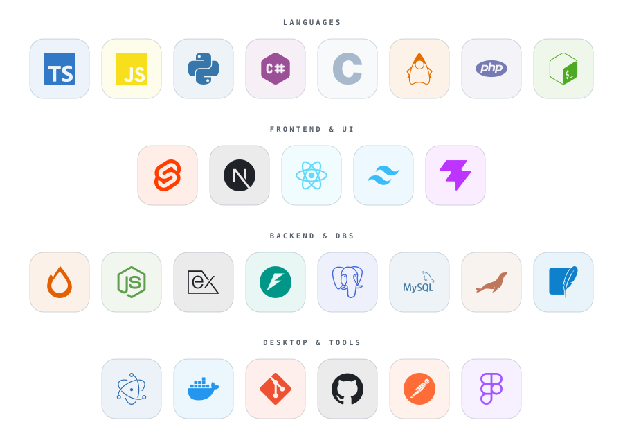
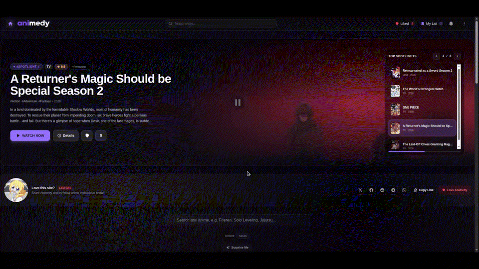
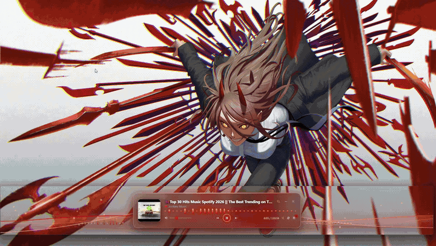
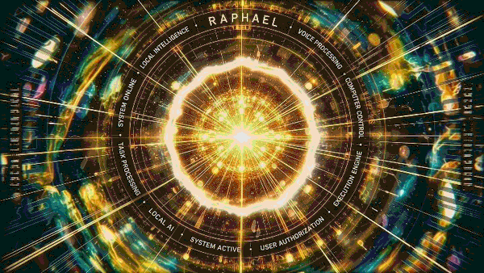

  <picture>
    <source media="(prefers-color-scheme: dark)" srcset="./assets/card-dark.svg">
    
  </picture>

Full-stack developer & systems builder in Cebu City, Philippines. I architect end-to-end operational software, internal tools, and desktop/web clients — bridging normalized relational databases with dependable, reactive user experiences. I care most about how systems hold up in production after the demo, when people depend on the software every day.

[GitHub](https://github.com/villariasa) · [LinkedIn](https://www.linkedin.com/in/medy-villarias) · [medyvillarias36@gmail.com](mailto:medyvillarias36@gmail.com)

**Now:** Full-stack systems developer at Litecloud Corp on CERPSYS. Building [Zynqelo](https://villariasa.github.io/zynqelo/) (thermal POS engine), [Animedy](https://animedy.pages.dev/) (Svelte 5 streaming engine), [Raphael](https://github.com/villariasa/Raphael) (agentic desktop client), and [Desktop Music Visualizer](https://github.com/villariasa/youtube-desktop-player) (audio-reactive desktop player). BS in Information Systems.

---

## Tech stack

  <picture>
    <source media="(prefers-color-scheme: dark)" srcset="./assets/tech-stack-dark.svg">
    <source media="(prefers-color-scheme: light)" srcset="./assets/tech-stack-light.svg">
    
  </picture>

  

##  Featured Production Engineering

<table>
<tr>
<td width="100%" valign="top">

  

###  <a href="https://github.com/villariasa/animedy" target="_blank" rel="noopener noreferrer">Animedy</a> &nbsp;•&nbsp; <a href="https://animedy.pages.dev/" target="_blank" rel="noopener noreferrer">Live Streaming Platform ↗</a>

  

A next-generation, **continuous anime streaming & discovery platform** built from the ground up for zero-friction binge-watching. Features dynamic multi-source video routing (VidSrc, MultiStream, Videasy), automated AniSkip intro/outro skipping, sub/dub switching, 50-episode rapid pagination tools, live dropdown search suggestions, and a dual-pane spotlight showcase — backed by resilient MariaDB metadata caching and high-throughput Hono micro-APIs.

`Svelte 5 (Runes)` `Hono v4` `MariaDB` `TypeScript` `Tailwind CSS v4` `AniList GraphQL` `Jikan REST` `AniSkip` `Cloudflare Pages`

</td>
</tr>
<tr>
<td width="100%" valign="top">

  

###  <a href="https://github.com/villariasa/youtube-desktop-player" target="_blank" rel="noopener noreferrer">Desktop Music Visualizer</a> &nbsp;•&nbsp; <a href="https://github.com/villariasa/youtube-desktop-player/releases" target="_blank" rel="noopener noreferrer">Release Downloads (v1.0.0) ↗</a>

  

An immersive, **desktop-wide audio-reactive music player & dynamic glassmorphism visualizer** engineered for continuous YouTube streaming. Powered by real-time native Windows WASAPI loopback audio capture and 60 FPS FFT frequency analysis, the desktop transforms into living energy with five silky continuous-spline flowing ribbons (vocal lead with glowing crest light beads, sub-bass 808 tectonic surge, interwoven harmonic silk, and high-treble shimmer) and studio peak-meter equalizer bars with floating gravity beads. Features real-time 1:1 wallpaper parallax blending with automated color harmony extraction, YouTube auto-next smart discovery, interactive playlist queue with official Tailwind Heroicons, and cross-platform ready-to-run installers for Windows and Linux.

`Python 3.11` `Edge WebView2 (pywebview)` `WASAPI Loopback` `FFT Frequency Analysis` `HTML5 Audio` `Tailwind Heroicons` `yt-dlp` `PyInstaller` `Inno Setup` `Linux .run`

</td>
</tr>
<tr>
<td width="100%" valign="top">

###  <a href="https://github.com/villariasa/Raphael" target="_blank" rel="noopener noreferrer">Raphael</a> &nbsp;•&nbsp; <a href="https://github.com/villariasa/Raphael" target="_blank" rel="noopener noreferrer">Local-First AI Desktop Operator ↗</a>

  

A privacy-centric, **local-first AI desktop assistant & agentic task operator** powered by Electron, React, and Ollama. Executes multi-step OS automation workflows with zero cloud telemetry, featuring a typed Safe Action Model (SAM), human-in-the-loop permission gates, transparent visual cursor overlays, and comprehensive audit trails.

`Electron 32` `React 18` `TypeScript` `Ollama (Local LLMs)` `Tailwind CSS` `Vite` `Zod`

</td>
</tr>
<tr>
<td width="100%" valign="top">

###  <a href="https://github.com/villariasa/removed-background" target="_blank" rel="noopener noreferrer">removed-background</a> &nbsp;•&nbsp; <a href="https://removed-background.pages.dev/" target="_blank" rel="noopener noreferrer">Live WebGPU App ↗</a>

A high-performance, **100% private in-browser AI background removal tool** powered by WebGPU and Transformers.js. Delivers instant neural cutouts without uploading files to external servers. Features an interactive precision refinement brush (shade to keep / shade to remove), adaptive edge feathering, and smart foreground detection.

`Next.js 15` `React 19` `TypeScript` `WebGPU` `Transformers.js` `Tailwind CSS` `Cloudflare Pages`

</td>
</tr>
<tr>
<td width="100%" valign="top">

###  <a href="https://github.com/villariasa/zynqelo" target="_blank" rel="noopener noreferrer">Zynqelo</a> &nbsp;•&nbsp; <a href="https://villariasa.github.io/zynqelo/" target="_blank" rel="noopener noreferrer">Live PWA / Web App ↗</a>

A modern, **100% private in-browser invoice & thermal receipt generator**. Zero tracking, zero accounts, and zero database storage. Features native 58mm/80mm POS receipt layouts, full standard paper support (A4, A5, Letter, Legal), on-device OCR receipt scanner, dynamic calculations, and instant high-resolution PDF export.

`Svelte 5` `TypeScript` `Tailwind CSS v4` `Vite` `jsPDF` `Tesseract.js` `GitHub Pages`

</td>
</tr>
</table>

  

## On GitHub

  <picture>
    <source media="(prefers-color-scheme: dark)" srcset="https://github-readme-stats-fast.vercel.app/api?username=villariasa&show_icons=true&hide_border=true&include_all_commits=true&rank_icon=github&disable_animations=true&bg_color=00000000&title_color=8B7CFF&icon_color=38D9F5&text_color=C9D1D9">
    
  </picture>
  <picture>
    <source media="(prefers-color-scheme: dark)" srcset="https://github-readme-stats-fast.vercel.app/api/top-langs?username=villariasa&layout=compact&hide_border=true&langs_count=8&disable_animations=true&bg_color=00000000&title_color=8B7CFF&text_color=C9D1D9">
    
  </picture>

  <picture>
    <source media="(prefers-color-scheme: dark)" srcset="./assets/contrib-dark.svg">
    <source media="(prefers-color-scheme: light)" srcset="./assets/contrib-light.svg">
    
  </picture>

  

##  Anime & Manhwa Vault

  
  &nbsp;
  

  Pure CSS auto-scrolling marquee rendered natively inside self-contained SVGs. Expand the drawers below for complete details and tracking links.

<b>▸ Anime Watchlist (Top 20 Curated)</b> — click to expand

 

  

1. [Solo Leveling](https://anilist.co/anime/151807) *(Favorite)*
2. [Bleach](https://anilist.co/anime/269) *(Favorite)*
3. [Tokyo Ghoul](https://anilist.co/anime/20605) *(Favorite)*
4. [Jujutsu Kaisen](https://anilist.co/anime/113415) *(Favorite)*
5. [That Time I Got Reincarnated as a Slime](https://anilist.co/anime/101280)
6. [Mushoku Tensei: Jobless Reincarnation](https://anilist.co/anime/108465)
7. [Re:ZERO -Starting Life in Another World-](https://anilist.co/anime/21355)
8. [Overlord](https://anilist.co/anime/20832)
9. [The Eminence in Shadow](https://anilist.co/anime/130298)
10. [Sword Art Online](https://anilist.co/anime/11757)
11. [KonoSuba](https://anilist.co/anime/21202)
12. [No Game No Life](https://anilist.co/anime/19815)
13. [The Rising of the Shield Hero](https://anilist.co/anime/99263)
14. [Demon Slayer: Kimetsu no Yaiba](https://anilist.co/anime/101922)
15. [Attack on Titan](https://anilist.co/anime/16498)
16. [Naruto / Naruto: Shippuden](https://anilist.co/anime/1735)
17. [One Piece](https://anilist.co/anime/21)
18. [Hunter x Hunter](https://anilist.co/anime/136)
19. [Fullmetal Alchemist: Brotherhood](https://anilist.co/anime/5114)
20. [The Misfit of Demon King Academy](https://anilist.co/anime/112301)

<b>▸ Manhwa Reading Rotation (Top 20 Curated)</b> — click to expand

 

  

1. [Revenge of the Iron-Blooded Sword Hound](https://anilist.co/manga/163824)
2. [The Great Mage Returns After 4000 Years](https://anilist.co/manga/118424)
3. Necromancer's Evolutionary Traits
4. [The Reincarnated Assassin Is a Genius Swordsman](https://anilist.co/manga/168823)
5. [Lookism](https://anilist.co/manga/86848) *(Favorite)*
6. [Star-Embracing Swordmaster](https://anilist.co/manga/170400)
7. [The Return of the Disaster-Class Hero](https://anilist.co/manga/143056)
8. Regression Instruction Manual
9. [Eleceed](https://anilist.co/manga/106929) *(Favorite)*
10. [The Regressed Mercenary's Machinations](https://anilist.co/manga/182066)
11. [Absolute Regression](https://anilist.co/manga/180891)
12. [Catastrophic Necromancer](https://anilist.co/manga/188225)
13. Chronicles of the Martial Gods' Return
14. [Return to Player](https://anilist.co/manga/124577)
15. [Absolute Sword Sense](https://anilist.co/manga/151460)
16. [Legend of the Northern Blade](https://anilist.co/manga/119521)
17. [Eternally Regressing Knight](https://anilist.co/manga/177706)
18. [Infinite Mage](https://anilist.co/manga/159930)
19. [Reality Quest](https://anilist.co/manga/141705)
20. [Return of the Mount Hua Sect](https://anilist.co/manga/132144) *(Favorite)*

  

  <i>"Architecting resilient systems. Shipping production software. Leveling up daily."</i>

