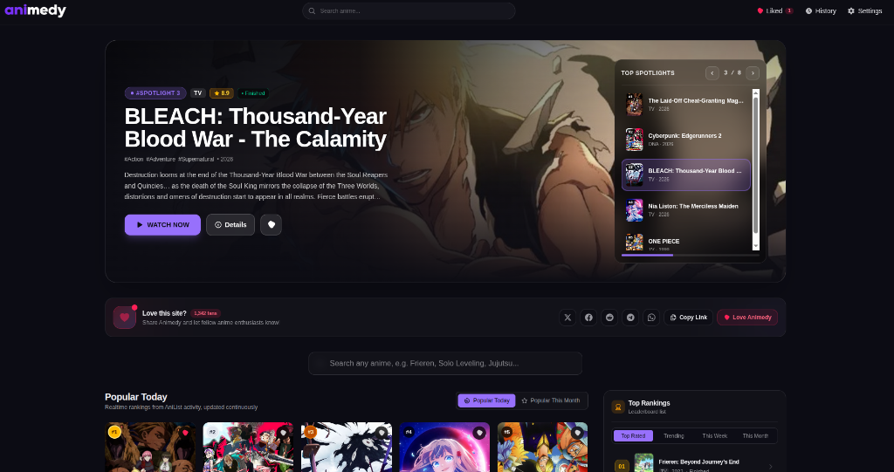

<div align="center">


<p align="center">
  <a href="https://github.com/villariasa"></a>
  
  
  
  
</p>

</div>

<br/>

##  Systems Architecture & Engineering Profile

<table>
<tr>
<td width="58%" valign="top">

I build **resilient, end-to-end operational software & intelligent clients** — bridging high-performance relational architectures and service backends with reactive, privacy-first user experiences.

- **High-Throughput Streaming & Media Engines:** Architected <a href="https://animedy.pages.dev/"><b>Animedy</b></a> with Svelte 5 (Runes), high-speed Hono micro-APIs, MariaDB caching, and zero-friction video routing.
- **Local-First & On-Device AI Systems:** Engineered <a href="https://github.com/villariasa/Raphael"><b>Raphael</b></a> (agentic Electron + Ollama OS automation) and <a href="https://removed-background.pages.dev/"><b>removed-background</b></a> (client-side WebGPU neural inference).
- **Mission-Critical POS & Operations:** Built <a href="https://villariasa.github.io/zynqelo/"><b>Zynqelo</b></a> (zero-telemetry thermal POS engine) alongside enterprise platforms with strict relational integrity, PL/pgSQL & MySQL stored procedures, and audit trails.
- **Education:** Bachelor of Science in Information Systems

</td>
<td width="42%" valign="top">

```text
ENGINEERING DOMAIN DISTRIBUTION

Backend & APIs     ██████████████████░░ 40%
Database Systems   ██████████████░░░░░░ 30%
Frontend & UI/UX   ██████████░░░░░░░░░░ 20%
Desktop & DevOps   █████░░░░░░░░░░░░░░░ 10%
───────────────────────────────────────────
CORE WORKFLOW PIPELINE
┌─────────────────────────────────────────┐
│ [ERD / 3NF Relational Normalization]    │
│                  │                      │
│                  ▼                      │
│   [Stored Procs & Service APIs]         │
│         │                  │            │
│         ▼                  ▼            │
│  [Reactive Web UI]   [Electron Desktop] │
│         │                  │            │
│         └────────┬─────────┘            │
│                  ▼                      │
│    [Production Load Verification]       │
└─────────────────────────────────────────┘
```

</td>
</tr>
</table>

<div align="center">
  
</div>

##  Tech Stack & Ecosystem

<p align="center">
  <a href="https://skillicons.dev">
    
  </a>
  <br/>
  <a href="https://skillicons.dev">
    
  </a>
</p>

<table>
<tr>
  <td width="22%"><b>Languages</b></td>
  <td><code>TypeScript</code> <code>JavaScript</code> <code>Python</code> <code>C#</code> <code>C</code> <code>Java</code> <code>PL/pgSQL</code> <code>Bash</code></td>
</tr>
<tr>
  <td width="22%"><b>Frontend & UI</b></td>
  <td><code>Svelte 5</code> <code>Next.js 15</code> <code>React 19</code> <code>Tailwind CSS v4</code> <code>WebGPU</code> <code>Vite</code></td>
</tr>
<tr>
  <td width="22%"><b>Backend & DBs</b></td>
  <td><code>Hono v4</code> <code>Node.js</code> <code>Express</code> <code>FastAPI</code> <code>PostgreSQL</code> <code>MySQL</code> <code>MariaDB</code> <code>SQLite</code></td>
</tr>
<tr>
  <td width="22%"><b>Desktop & Tools</b></td>
  <td><code>Electron</code> <code>Inno Setup</code> <code>Docker</code> <code>Git</code> <code>GitHub</code> <code>Postman</code> <code>Figma</code></td>
</tr>
</table>

<details>
<summary><b>▸ View Categorized Shield Badges</b> (click to expand)</summary>
<br/>

###  Languages & Runtimes
<p>
  
  
  
  
  
  
  
  
  
  
</p>

###  Frontend & Reactive Frameworks
<p>
  
  
  
  
  
  
</p>

###  Backend, Systems & APIs
<p>
  
  
  
  
  
  
</p>

###  Desktop & Native Engineering
<p>
  
  
  
</p>

###  Relational Databases & Storage
<p>
  
  
  
  
  
</p>

###  DevOps, Tooling & Workflow
<p>
  
  
  
  
  
  
  
</p>

</details>

<div align="center">
  
</div>

##  Featured Production Engineering

<table>
<tr>
<td width="100%" valign="top">

<div align="right">
  
</div>

###  <a href="https://github.com/villariasa/animedy" target="_blank" rel="noopener noreferrer">Animedy</a> &nbsp;•&nbsp; <a href="https://animedy.pages.dev/" target="_blank" rel="noopener noreferrer">Live Streaming Platform ↗</a>

<p align="center">
  <a href="https://animedy.pages.dev/" target="_blank" rel="noopener noreferrer">
    
  </a>
</p>

A next-generation, **continuous anime streaming & discovery platform** built from the ground up for zero-friction binge-watching. Features dynamic multi-source video routing (VidSrc, MultiStream, Videasy), automated AniSkip intro/outro skipping, sub/dub switching, 50-episode rapid pagination tools, live dropdown search suggestions, and a dual-pane spotlight showcase — backed by resilient MariaDB metadata caching and high-throughput Hono micro-APIs.

`Svelte 5 (Runes)` `Hono v4` `MariaDB` `TypeScript` `Tailwind CSS v4` `AniList GraphQL` `Jikan REST` `AniSkip` `Cloudflare Pages`

</td>
</tr>
<tr>
<td width="100%" valign="top">

###  <a href="https://github.com/villariasa/Raphael" target="_blank" rel="noopener noreferrer">Raphael</a> &nbsp;•&nbsp; <a href="https://github.com/villariasa/Raphael" target="_blank" rel="noopener noreferrer">Local-First AI Desktop Operator ↗</a>

A privacy-centric, **local-first AI desktop assistant & agentic task operator** powered by Electron, React, and Ollama. Executes multi-step OS automation workflows with zero cloud telemetry, featuring a typed Safe Action Model (SAM), human-in-the-loop permission gates, transparent visual cursor overlays, and comprehensive audit trails.

`Electron 32` `React 18` `TypeScript` `Ollama (Local LLMs)` `Tailwind CSS` `Vite` `Zod`

</td>
</tr>
<tr>
<td width="100%" valign="top">

###  <a href="https://github.com/villariasa/removed-background" target="_blank" rel="noopener noreferrer">removed-background</a> &nbsp;•&nbsp; <a href="https://removed-background.pages.dev/" target="_blank" rel="noopener noreferrer">Live WebGPU App ↗</a>

A high-performance, **100% private in-browser AI background removal tool** powered by WebGPU and Transformers.js. Delivers instant neural cutouts without uploading files to external servers. Features an interactive precision refinement brush (shade to keep / shade to remove), adaptive edge feathering, and smart foreground detection.

`Next.js 15` `React 19` `TypeScript` `WebGPU` `Transformers.js` `Tailwind CSS` `Cloudflare Pages`

</td>
</tr>
<tr>
<td width="100%" valign="top">

###  <a href="https://github.com/villariasa/zynqelo" target="_blank" rel="noopener noreferrer">Zynqelo</a> &nbsp;•&nbsp; <a href="https://villariasa.github.io/zynqelo/" target="_blank" rel="noopener noreferrer">Live PWA / Web App ↗</a>

A modern, **100% private in-browser invoice & thermal receipt generator**. Zero tracking, zero accounts, and zero database storage. Features native 58mm/80mm POS receipt layouts, full standard paper support (A4, A5, Letter, Legal), on-device OCR receipt scanner, dynamic calculations, and instant high-resolution PDF export.

`Svelte 5` `TypeScript` `Tailwind CSS v4` `Vite` `jsPDF` `Tesseract.js` `GitHub Pages`

</td>
</tr>
</table>

<div align="center">
  
</div>

##  GitHub Analytics & Operational Metrics

<p align="center">
  
  &nbsp;
  
</p>

<p align="center">
  
</p>

<div align="center">
  
</div>

##  Anime & Manhwa Vault

<p align="center">
  <a href="#anime-watchlist"></a>
  &nbsp;
  <a href="#manhwa-reading-rotation"></a>
</p>

<p align="center">
  <sub>Pure CSS auto-scrolling marquee rendered natively inside self-contained SVGs. Expand the drawers below for complete details and tracking links.</sub>
</p>

<a name="anime-watchlist"></a>
<details open>
<summary><b>▸ Anime Watchlist (Top 20 Curated)</b> — click to collapse</summary>
<br/>

<p align="center">
  
</p>

1. [Solo Leveling](https://anilist.co/anime/151807) *(Favorite)*
2. [Bleach](https://anilist.co/anime/269) *(Favorite)*
3. [Tokyo Ghoul](https://anilist.co/anime/20605) *(Favorite)*
4. [Jujutsu Kaisen](https://anilist.co/anime/113415) *(Favorite)*
5. [That Time I Got Reincarnated as a Slime](https://anilist.co/anime/101280)
6. [Mushoku Tensei: Jobless Reincarnation](https://anilist.co/anime/108465)
7. [Re:ZERO -Starting Life in Another World-](https://anilist.co/anime/21355)
8. [Overlord](https://anilist.co/anime/20832)
9. [The Eminence in Shadow](https://anilist.co/anime/130298)
10. [Sword Art Online](https://anilist.co/anime/11757)
11. [KonoSuba](https://anilist.co/anime/21202)
12. [No Game No Life](https://anilist.co/anime/19815)
13. [The Rising of the Shield Hero](https://anilist.co/anime/99263)
14. [Demon Slayer: Kimetsu no Yaiba](https://anilist.co/anime/101922)
15. [Attack on Titan](https://anilist.co/anime/16498)
16. [Naruto / Naruto: Shippuden](https://anilist.co/anime/1735)
17. [One Piece](https://anilist.co/anime/21)
18. [Hunter x Hunter](https://anilist.co/anime/136)
19. [Fullmetal Alchemist: Brotherhood](https://anilist.co/anime/5114)
20. [The Misfit of Demon King Academy](https://anilist.co/anime/112301)

</details>

<a name="manhwa-reading-rotation"></a>
<details>
<summary><b>▸ Manhwa Reading Rotation (Top 20 Curated)</b> — click to expand</summary>
<br/>

<p align="center">
  
</p>

1. [Revenge of the Iron-Blooded Sword Hound](https://anilist.co/manga/163824)
2. [The Great Mage Returns After 4000 Years](https://anilist.co/manga/118424)
3. Necromancer's Evolutionary Traits
4. [The Reincarnated Assassin Is a Genius Swordsman](https://anilist.co/manga/168823)
5. [Lookism](https://anilist.co/manga/86848) *(Favorite)*
6. [Star-Embracing Swordmaster](https://anilist.co/manga/170400)
7. [The Return of the Disaster-Class Hero](https://anilist.co/manga/143056)
8. Regression Instruction Manual
9. [Eleceed](https://anilist.co/manga/106929) *(Favorite)*
10. [The Regressed Mercenary's Machinations](https://anilist.co/manga/182066)
11. [Absolute Regression](https://anilist.co/manga/180891)
12. [Catastrophic Necromancer](https://anilist.co/manga/188225)
13. Chronicles of the Martial Gods' Return
14. [Return to Player](https://anilist.co/manga/124577)
15. [Absolute Sword Sense](https://anilist.co/manga/151460)
16. [Legend of the Northern Blade](https://anilist.co/manga/119521)
17. [Eternally Regressing Knight](https://anilist.co/manga/177706)
18. [Infinite Mage](https://anilist.co/manga/159930)
19. [Reality Quest](https://anilist.co/manga/141705)
20. [Return of the Mount Hua Sect](https://anilist.co/manga/132144) *(Favorite)*

</details>

<div align="center">
  
</div>

<div align="center">

<p align="center">
  <i>"Architecting resilient systems. Shipping production software. Leveling up daily."</i>
</p>


</div>
